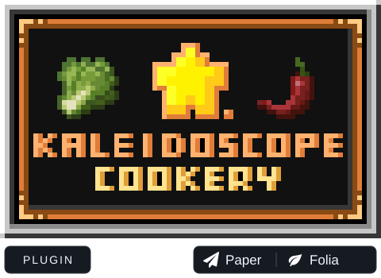

  

<h1 align="center">Kaleidoscope Cookery Plugin</h1>

Chop, stir-fry, steam and serve Chinese dishes in your own Paper or Folia kitchen.

  
  
  
  

  <a href="https://github.com/Nicoppara/KaleidoscopeCookery_Plugin/releases">Downloads &amp; updates</a> ·
  <a href="#installation">Installation</a> ·
  <a href="#documentation">Documentation</a> ·
  <a href="https://github.com/Nicoppara/KaleidoscopeCookery_Plugin/issues">Issues</a> 
  <strong>English</strong> · <a href="README.zh-CN.md">简体中文</a>

## 🍳 About

**KaleidoscopeCookeryPlugin** brings [Kaleidoscope Cookery](https://github.com/KaleidoscopeMods/KaleidoscopeCookery) to CraftEngine servers. Players can chop ingredients, stir-fry, simmer soups, steam, grind and plate dishes using a vanilla client and the server resource pack. No client mods are required.

CraftEngine supplies the custom items, blocks and resource pack; this plugin handles cookware interactions, processing, recipe menus and advancement integration. Kaleidoscope Cookery Plugin and [Farmer's Delight](https://github.com/Nodemc-developing/Farmersdelight-Plugin-Pro) are installed separately and can be used with your server's content packs.

## 📊 Usage statistics

  

Reports from servers with bStats enabled. Data updates every 30 minutes; image caches may delay changes. Click the chart for the full dashboard.

## ✨ Features

| Feature | Included |
| --- | --- |
| 🍳 Chinese cooking | Woks, stockpots, steamers, shawarma spits, millstones, chopping boards and teapots |
| 🥕 Flexible recipes | Exact recipes, ingredient groups, equivalent ingredients, seasonings, ingredient ratios and dish quality |
| ⏱️ Per-recipe processing | Cooking time, stir-fry count, chopping stages and grinding rotations; edits apply to the next batch |
| 📖 Recipe browser | Cookware categories and pagination; results keep their original CE item Lore, with quality advice on a separate hover icon |
| 🛠️ In-game editor | Edit recipes and processing settings, restore inherited values and save changes to the original recipe files |
| 🌾 Farming & dining | Rice and other crops, scarecrows, placeable dishes, tables, chairs, cookware racks and trash cans, provided by the installed content pack |
| 🏆 Kitchen advancements | Optional UltimateAdvancementAPI integration, including cooking, noodle stretching, throwing buns to wolves and fish–rice farming |
| 🛡️ Land protection | Bundled AntiGriefLib integration with compatible land and protection plugins |
| 🌐 Localization & extensions | Multilingual console messages, PlaceholderAPI variables, gameplay events and recipe-menu APIs |

### Cookware

| Cookware | Processing | Recipe setting |
| --- | --- | --- |
| Wok | Add oil and ingredients, stir-fry, then serve | `stir_fry_count` — stir-fry count |
| Stockpot | Add a soup base and ingredients, close the lid and simmer | `cooking_time` — simmering time |
| Steamer | Steam ingredients in separate slots; baskets can stack | `cooking_time` — timed per ingredient |
| Shawarma spit | Redstone-controlled rotation with multiple cooking layers | `cooking_time` — timed per slot |
| Teapot | Add liquid and tea ingredients, brew, then pour into cups | `time`, with `cooking_time` as an alias |
| Chopping board | Cut ingredients with a kitchen knife | `stage` — required cuts |
| Millstone | Grind by hand or with an animal | `rotations` — required rotations |

Stoves control heat, enamel basins store oil and cookware racks hold kitchen tools. YAML durations use integer ticks; the editor displays and accepts seconds. See [processing time and work counts (Chinese)](docs/CONFIGURATION.zh-CN.md#processing).

## 🧩 Requirements

| Component | Version or requirement | Purpose |
| --- | --- | --- |
| Paper or Folia | A corresponding build for Minecraft **1.21–26.3** | Server runtime; Folia requires an available build for your Minecraft version |
| Java | **Java 21 for 1.21.x; Java 25 for 26.x** | Server runtime |
| [CraftEngine](https://github.com/Xiao-MoMi/craft-engine) | **26.9.2 / 26.10-SNAPSHOT** | Required for items, blocks, recipes and resource packs |
| Complete Kaleidoscope content pack | Matching the plugin version | Required for gameplay configuration, models, textures and sounds |
| [UltimateAdvancementAPI](https://github.com/Nodemc-developing/UltimateAdvancementAPI) | Optional, compatible **2.8.1 Pro** build | Kitchen advancements |
| [PlaceholderAPI](https://github.com/PlaceholderAPI/PlaceholderAPI) | Optional | Plugin status and recipe statistics; the expansion registers automatically |

These versions describe the server adaptation range. Not every Minecraft patch or third-party plugin combination has received a full compatibility check. See the [development guide (Chinese)](docs/DEVELOPMENT.zh-CN.md#build) for the CE compilation baseline and version adapters.

## 🚀 Installation

1. Prepare a supported Paper or Folia server, the matching Java version and CraftEngine. Put the plugin JAR in `plugins/`.
2. Manually install a **matching, complete Kaleidoscope content pack** in `plugins/CraftEngine/resources/`. Its root `pack.yml` must declare `namespace: kaleidoscopecookery`.
3. For advancements and the newer menu hints, merge the supplementary files from [`Kaleidoscope/kaleidoscopecookery/`](Kaleidoscope/kaleidoscopecookery/) into that complete pack. This repository directory contains only pack metadata, advancement text and the quality-hint icon; it does not replace a complete pack.
4. Install any optional dependencies you need, start the server and check that CraftEngine loads the content.
5. Generate and distribute the client resource pack through CraftEngine. Players can accept it and browse recipes with `/kcrecipe`.

Plugin settings are in `plugins/KaleidoscopeCookeryPlugin/config.yml`; cookware, ingredients and recipes belong to CraftEngine content packs. The plugin does not automatically extract complete Kaleidoscope or Farmer's Delight packs. Back up your configuration, worlds and player data before updating. Restart after replacing the JAR. Reload content configuration with `/ce reload all`; model, texture and font changes also require an updated client resource pack.

## 🎮 Commands & permissions

| Command | Action | Permission |
| --- | --- | --- |
| `/kcrecipe` | Browse recipes | `kaleidoscopecookery.recipe.browse` |
| `/kcrecipe edit` | Edit recipes and processing settings | `kaleidoscopecookery.recipe.edit` |
| `/kcfood`, `/kcfood edit` | Aliases for the commands above | Same as the corresponding command |
| `/ce reload all` | Reload CraftEngine content and Kaleidoscope settings | Corresponding CraftEngine administration permission |

Recipe browsing and editing both default to OP. To let regular players browse, grant only the browse permission. The land-protection bypass permission is `kaleidoscopecookery.antigrief.bypass`.

## 📚 Documentation

The detailed guides below are currently in Chinese.

| Guide | Contents |
| --- | --- |
| [Configuration & recipes](docs/CONFIGURATION.zh-CN.md) | Content layout, templates, factories, tags, cookware behaviors and recipe formats |
| [Processing time & work counts](docs/CONFIGURATION.zh-CN.md#processing) | Cookware fields, defaults, inheritance and when edits take effect |
| [Ingredient groups & seasonings](docs/CONFIGURATION.zh-CN.md#food-groups) | Equivalent ingredients, seasonings and their switches |
| [Kitchen advancements](docs/ADVANCEMENTS.zh-CN.md) | Available advancements, conditions, setup and settings |
| [Development & API](docs/DEVELOPMENT.zh-CN.md) | Building, events, registries and recipe-menu extensions |
| [Menu appearance](docs/DEVELOPMENT.zh-CN.md#recipe-menu) · [PlaceholderAPI](docs/CONFIGURATION.zh-CN.md#placeholders) | Menu settings, custom interfaces and available variables |

## 🙏 Credits & licenses

The standalone source file explicitly listed in [LICENSE-OWN-CODE.txt](LICENSE-OWN-CODE.txt) is marked `LicenseRef-ARR` (All Rights Reserved). This limited notice does not relicense the plugin as a whole; all other content retains its existing terms.

Thanks to the **Kaleidoscope Official Production Team** for the [original mod](https://github.com/KaleidoscopeMods/KaleidoscopeCookery), its gameplay, artwork and game text, and to projects including [CraftEngine](https://github.com/Xiao-MoMi/craft-engine) and [AntiGriefLib](https://github.com/Xiao-MoMi/AntiGriefLib).

Upstream code uses [BSD-3-Clause](src/main/resources/licenses/KaleidoscopeCookery-LICENSE-CODE.txt). Upstream artwork and game text use [CC BY-NC-SA 4.0](src/main/resources/licenses/KaleidoscopeCookery-LICENSE-ASSETS.txt), retaining their attribution and license terms. See the [source notice](src/main/resources/licenses/KaleidoscopeCookery-NOTICE.txt) for the ported material.

The kitchen logo comes from the [original mod's MC百科 page](https://www.mcmod.cn/class/20850.html). The Paper and Folia icons come from the [PaperMC website](https://github.com/PaperMC/website/tree/ff5fe868b2ceec6456eaa42368e46afa72a28381/src/assets/brand) and identify compatible server platforms.
