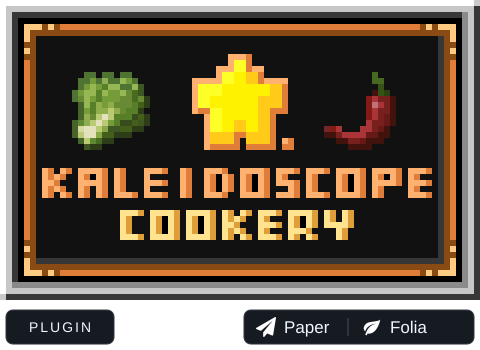

  

<h1 align="center">森罗物语：厨房插件 · Kaleidoscope Cookery Plugin</h1>

在 Paper 与 Folia 上，从切菜、翻炒到蒸煮摆盘，打造自己的中式厨房。

  
  
  
  

  <a href="https://github.com/Nicoppara/KaleidoscopeCookery_Plugin/releases">下载与更新</a> ·
  <a href="#installation">安装</a> ·
  <a href="#documentation">文档</a> ·
  <a href="https://github.com/Nicoppara/KaleidoscopeCookery_Plugin/issues">问题反馈</a> 
  <a href="README.md">English</a> · <strong>简体中文</strong>

## 🍳 关于

**KaleidoscopeCookeryPlugin** 是[森罗物语：厨房](https://github.com/KaleidoscopeMods/KaleidoscopeCookery)的 CraftEngine 服务端移植。玩家使用原版客户端并接受服务器资源包，即可体验切配、炒菜、炖汤、蒸制、研磨与摆盘，无需安装客户端模组。

CraftEngine 提供自定义物品、方块与资源包，本插件负责厨具交互、加工流程、食谱菜单及成就联动。森罗物语与[农夫乐事](https://github.com/Nodemc-developing/Farmersdelight-Plugin-Pro)独立安装，也可配合服务器的内容包使用。

## ✨ 功能

| 功能 | 包含内容 |
| --- | --- |
| 🍳 中式烹饪 | 炒锅翻炒、高汤锅炖煮、蒸笼蒸制、沙威玛烤架、石磨、砧板与茶壶 |
| 🥕 灵活配方 | 精准配方、食材分组、等效食材、调味品、投料配比与料理品质 |
| ⏱️ 每配方加工设置 | 独立烹饪时间、翻炒次数、切配刀数与研磨圈数；修改从下一批次生效 |
| 📖 食谱浏览 | 按厨具分类与翻页；成品保留 CE 原物品 Lore，品质说明通过独立注意图标悬停查看 |
| 🛠️ 游戏内编辑 | 编辑配方与加工参数，恢复继承值，将修改保存回原配方文件 |
| 🌾 田园与餐厅 | 水稻等作物、稻草人、可摆放菜品、桌椅、厨具架与垃圾桶；内容由所安装资源包提供 |
| 🏆 森罗厨房成就 | 可选 UltimateAdvancementAPI 联动，包含烹饪、拉面、肉包打狗与鱼稻共生等目标 |
| 🛡️ 领地保护 | 内置 AntiGriefLib，接入兼容的领地与保护插件 |
| 🌐 本地化与扩展 | 多语言控制台、PlaceholderAPI 变量、玩法事件及食谱菜单 API |

### 厨具玩法

| 厨具 | 加工方式 | 配方可调参数 |
| --- | --- | --- |
| 炒锅 | 倒油、投料、翻炒后盛出 | `stir_fry_count` 翻炒次数 |
| 高汤锅 | 加汤底、投料、盖盖炖煮 | `cooking_time` 炖煮时间 |
| 蒸笼 | 分槽蒸制，可叠放 | `cooking_time` 每份食材独立计时 |
| 沙威玛烤架 | 红石控制旋转，分层烤制 | `cooking_time` 每槽独立计时 |
| 茶壶 | 加液体与茶料，熬煮后倒入茶杯 | `time`，兼容 `cooking_time` |
| 砧板 | 手持菜刀逐次切配 | `stage` 刀数 |
| 石磨 | 玩家推磨或生物拉磨 | `rotations` 圈数 |

炉灶、搪瓷盆与厨具架提供控火、储油及收纳等配套交互。时间在 YAML 中使用整数 tick，菜单以秒编辑；详见[加工时间与次数](docs/CONFIGURATION.zh-CN.md#processing)。

## 🧩 环境与依赖

| 组件 | 版本或要求 | 用途 |
| --- | --- | --- |
| Paper 或 Folia | Minecraft **1.21–26.3** 的对应构建 | 服务端；Folia 需有相应版本的可用核心 |
| Java | **1.21.x 用 Java 21；26.x 用 Java 25** | 服务端运行环境 |
| [CraftEngine](https://github.com/Xiao-MoMi/craft-engine) | **26.9.2 / 26.10-SNAPSHOT** | 必需，加载物品、方块、配方与资源包 |
| 完整森罗内容包 | 与插件版本匹配 | 必需，提供玩法配置、模型、贴图及音效 |
| [UltimateAdvancementAPI](https://github.com/Nodemc-developing/UltimateAdvancementAPI) | 可选，兼容的 **2.8.1 Pro** 构建 | 森罗厨房成就 |
| [PlaceholderAPI](https://github.com/PlaceholderAPI/PlaceholderAPI) | 可选 | 插件状态与配方统计变量，自动注册扩展 |

以上为服务端适配范围，不代表每个 Minecraft 补丁版本与第三方插件组合都经过完整验收。CE 编译基线和多版本适配说明见[开发文档](docs/DEVELOPMENT.zh-CN.md#build)。

## 🚀 安装

1. 准备受支持的 Paper / Folia、对应 Java 与 CraftEngine，将森罗插件 JAR 放入 `plugins/`。
2. 手动安装**匹配版本的完整森罗内容包**到 `plugins/CraftEngine/resources/`。包根的 `pack.yml` 必须声明 `namespace: kaleidoscopecookery`。
3. 如需成就与新版菜单提示，将仓库 [`Kaleidoscope/kaleidoscopecookery/`](Kaleidoscope/kaleidoscopecookery/) 中的增补文件合并到这个完整内容包。该目录只包含包元数据、成就文本与品质提示图标，不能单独替代完整包。
4. 按需安装可选依赖，启动服务器，确认 CraftEngine 正常加载内容。
5. 按 CraftEngine 流程生成并分发客户端资源包，玩家接受后即可体验；使用 `/kcrecipe` 浏览食谱。

插件设置位于 `plugins/KaleidoscopeCookeryPlugin/config.yml`；厨具、食材与配方由 CraftEngine 内容包管理。插件不会自动释放完整森罗包或农夫乐事包。升级前备份现有配置、世界与玩家数据，替换 JAR 后重启；修改内容配置后执行 `/ce reload all`，模型、贴图和字体变更还需更新客户端资源包。

## 🎮 命令与权限

| 命令 | 用途 | 所需权限 |
| --- | --- | --- |
| `/kcrecipe` | 浏览食谱 | `kaleidoscopecookery.recipe.browse` |
| `/kcrecipe edit` | 编辑配方与加工设置 | `kaleidoscopecookery.recipe.edit` |
| `/kcfood`、`/kcfood edit` | 上述命令的别名 | 与对应命令相同 |
| `/ce reload all` | 重载 CraftEngine 内容及森罗配置 | CraftEngine 对应的管理权限 |

食谱浏览和编辑权限默认均为 OP；开放给普通玩家时，仅授予浏览权限即可。领地交互的绕过权限为 `kaleidoscopecookery.antigrief.bypass`。

## 📚 文档

| 文档 | 内容 |
| --- | --- |
| [配置与配方](docs/CONFIGURATION.zh-CN.md) | 内容目录、模板、工厂、标签、厨具行为与配方格式 |
| [加工时间与次数](docs/CONFIGURATION.zh-CN.md#processing) | 各厨具字段、默认值、继承与批次生效规则 |
| [食材组与调味品](docs/CONFIGURATION.zh-CN.md#food-groups) | 等效食材、调味品及相关开关 |
| [森罗厨房成就](docs/ADVANCEMENTS.zh-CN.md) | 成就范围、条件、安装与开关 |
| [开发与 API](docs/DEVELOPMENT.zh-CN.md) | 构建、事件、注册表与食谱菜单扩展 |
| [菜单外观](docs/DEVELOPMENT.zh-CN.md#recipe-menu) · [PlaceholderAPI](docs/CONFIGURATION.zh-CN.md#placeholders) | 菜单配置、界面接管及可用变量 |

## 🙏 致谢与许可

感谢 **Kaleidoscope Official Production Team（森罗物语官方制作组）**提供[原模组](https://github.com/KaleidoscopeMods/KaleidoscopeCookery)的玩法、美术与游戏文本，以及 [CraftEngine](https://github.com/Xiao-MoMi/craft-engine)、[AntiGriefLib](https://github.com/Xiao-MoMi/AntiGriefLib) 等项目。

上游代码采用 [BSD-3-Clause](src/main/resources/licenses/KaleidoscopeCookery-LICENSE-CODE.txt)，上游美术与游戏文本采用 [CC BY-NC-SA 4.0](src/main/resources/licenses/KaleidoscopeCookery-LICENSE-ASSETS.txt)，保留各自署名及许可；移植范围见[来源说明](src/main/resources/licenses/KaleidoscopeCookery-NOTICE.txt)。

首页厨房 Logo 取自[原模组 MC 百科页面](https://www.mcmod.cn/class/20850.html)；Paper / Folia 图标来自 [PaperMC 官网](https://github.com/PaperMC/website/tree/ff5fe868b2ceec6456eaa42368e46afa72a28381/src/assets/brand)，用于标示兼容平台。
